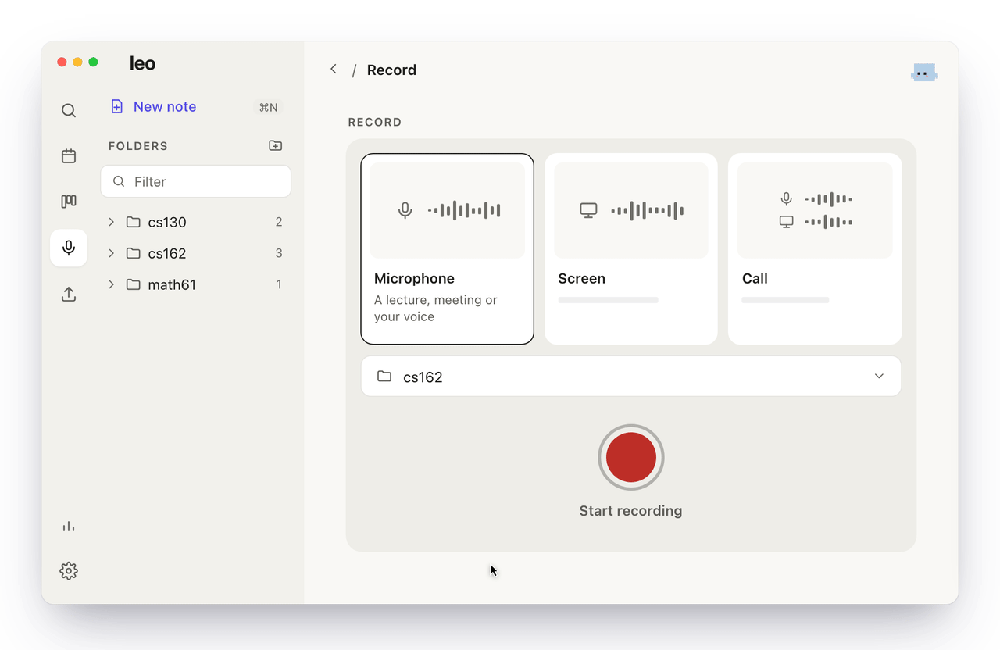

# leo

**Record a lecture, get the notes, then get quizzed on them.**

leo is a note app for macOS and Windows. It transcribes on your computer, writes
your recordings up as Markdown notes, and Felix helps you study them. Your notes
are plain files in a folder you own.

[Download](https://github.com/chewton2k/leo-cli/releases/latest) · [Install](#install) · [Install guide](docs/install.md)

<picture>
  <source media="(prefers-color-scheme: dark)" srcset="docs/assets/demo-dark.gif">
  
</picture>

## Install

Download the [macOS `.dmg` or Windows `-setup.exe`](https://github.com/chewton2k/leo-cli/releases/latest)
and open it. The [install guide](docs/install.md) covers the first launch,
updates, uninstalling and moving from the old terminal version.

Or install from a terminal.

macOS:

```sh
curl -fsSL https://github.com/chewton2k/leo-cli/releases/latest/download/install.sh | sh
```

Windows, in PowerShell:

```powershell
irm https://github.com/chewton2k/leo-cli/releases/latest/download/install.ps1 | iex
```

## What it does

- **Record.** A lecture, meeting or call becomes a note: leo transcribes it
  locally, then writes up the main ideas in the folder you chose.
- **Study with Felix.** Ask about your notes, learn a topic one step at a time,
  or get quizzed and marked on what you wrote.
- **Dictate anywhere.** Press Option+Space (Ctrl+Space on Windows), speak, and
  leo pastes your words into whatever app you're in.
- **Plan.** Tasks, a calendar and boards sit beside your notes.

## Private by default

Speech never leaves your computer: recording and dictation use a local model you
pick in Settings. Writing AI uses your signed-in Claude Code or Codex plan, or a
local Ollama model. Notes are Markdown files with front matter, so Obsidian,
git and any editor can read them.

[Contributing](CONTRIBUTING.md) · [Developer guide](DEVELOPER.md)

## License

MIT. Speech models have their own licenses, listed in the vendored
[model catalog](crates/leo-services/src/speech/catalog.json).
See [NOTICE](NOTICE) for third-party attribution.
