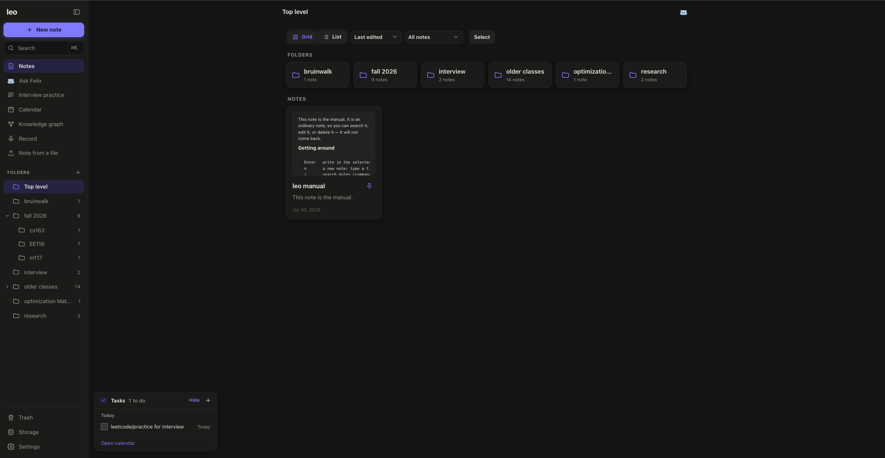
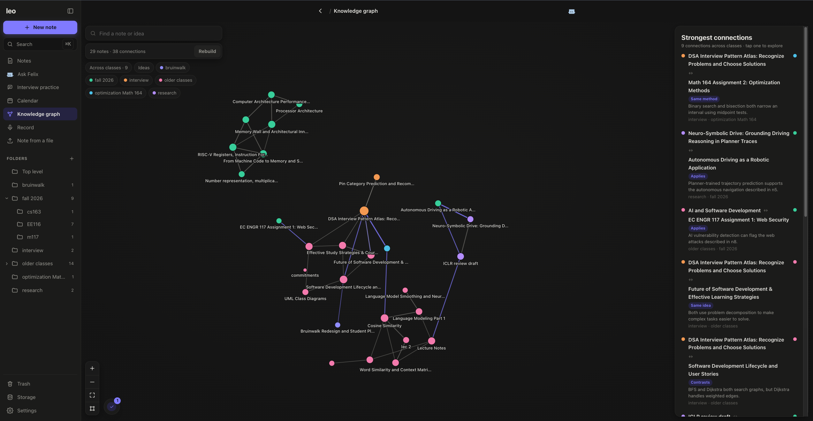
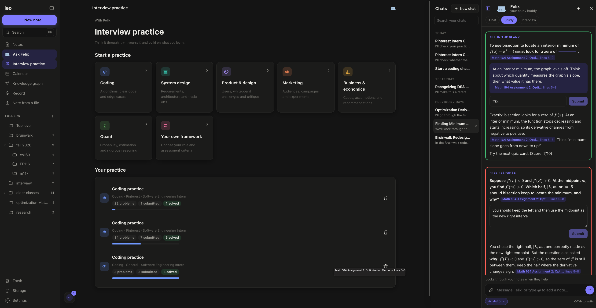
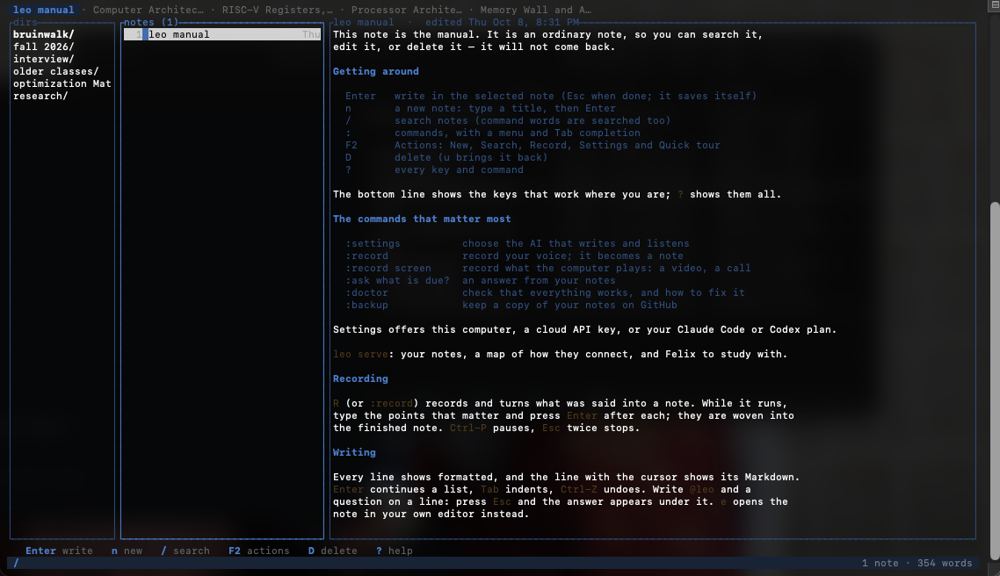

# leo

Local notes, recording, and interview practice, with Felix to help you study.
Your notes stay as Markdown files on your computer. Use leo in your browser or
terminal, with AI powered by your signed-in Claude Code or Codex plan, a local
model, or your own API key.

## Install

**macOS / Linux**

```sh
curl -fsSL https://raw.githubusercontent.com/chewton2k/leo-cli/main/install.sh | bash
```

**Windows** (64-bit Intel / AMD, PowerShell)

```powershell
irm https://raw.githubusercontent.com/chewton2k/leo-cli/main/install.ps1 | iex
```

The installer checks the download, adds leo to your PATH, and downloads the
speech model for local transcription. Open leo like any other app, or run `leo`
in a terminal to open it. Choose your AI in Settings when you need it, and run
`leo update` to get updates.

## What you can do

**Organize your notes.** Browse folders in a grid or list, search your notes, and
keep tasks close by.



**Find connections.** Explore how ideas relate across your notes and classes,
with explanations for each connection.



**Practice and study with Felix.** Prepare for coding, system design, and other
interviews, track your progress, or study your notes with questions and feedback.



**Stay in your terminal.** Write and search Markdown notes, record lectures or
meetings, and ask questions without leaving the keyboard.



[Contributing](CONTRIBUTING.md) · [Developer guide](DEVELOPER.md)

## License

MIT. Local speech recognition uses NVIDIA's
[Parakeet TDT 0.6B v3](https://huggingface.co/nvidia/parakeet-tdt-0.6b-v3)
([CC-BY-4.0](https://creativecommons.org/licenses/by/4.0/)), converted to ONNX and
run by [sherpa-onnx](https://github.com/k2-fsa/sherpa-onnx) (Apache-2.0).
