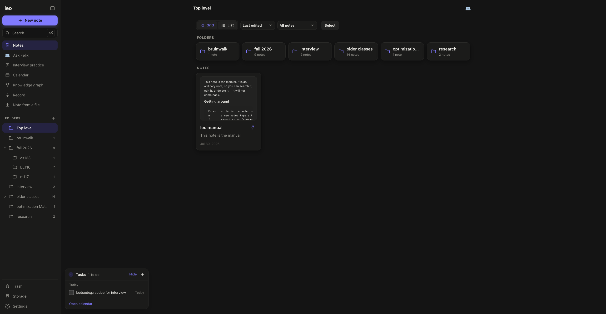
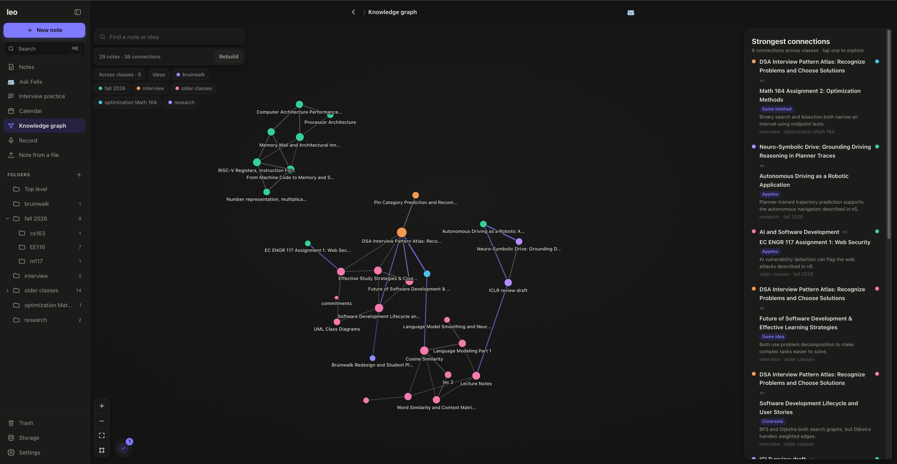
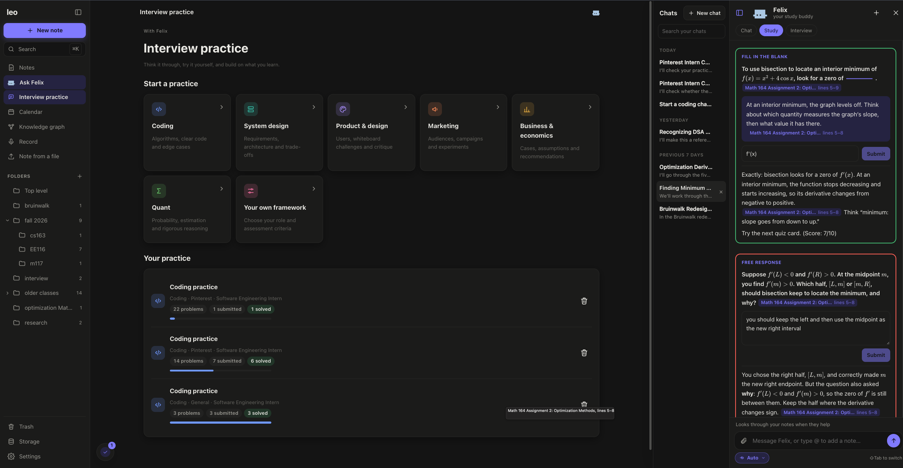

# leo

Leo is a desktop note app for macOS and Windows, with local recording and
dictation, interview practice, and Felix to help you study. Your notes stay as
Markdown files on your computer. Writing AI uses your signed-in Claude Code or
Codex plan, or a local Ollama model.

## Install

The desktop release is being prepared. Once published, download the macOS disk
image or Windows installer from [Releases](https://github.com/chewton2k/leo-cli/releases).
Choose Apple Silicon or Intel on macOS; Windows uses the x64 installer.
Linux is not supported.

On macOS, drag Leo into Applications. For browser downloads on macOS 15, open
System Settings → Privacy & Security and choose **Open Anyway** after the first
attempt to open Leo. The app uses a stable self-signed certificate; it is not
notarized. Windows browser downloads may show a SmartScreen prompt.

The app installers are also available from the release:

```sh
curl -fsSL https://github.com/chewton2k/leo-cli/releases/latest/download/install.sh | sh
```

On Windows, in PowerShell:

```powershell
irm https://github.com/chewton2k/leo-cli/releases/latest/download/install.ps1 | iex
```

These commands become available with the first desktop release. The existing
main-branch installers switch over automatically only after all app assets are
published, so older Leo installations can update safely.

The macOS installer puts Leo in `/Applications`; Windows uses
`%LOCALAPPDATA%\Leo`. The terminal command points into the app, so app updates
update it too. `LEO_INSTALL_DIR` chooses the terminal command's folder;
`LEO_INSTALL_SKIP_PATH=1` leaves your shell or user PATH unchanged.

Open Leo like any other app, or type `leo` in a terminal. First launch offers
three skippable steps: microphone, Accessibility, and a local speech model.
Dictation defaults to Option+Space on macOS and Ctrl+Space on Windows; rebind it
in Settings. Models and speech stay on this computer. Choose Writing AI when
you need it; dictation never uses writing AI.

Settings → Health has setup checks and fixes. Updates & about checks for app
updates, shows what changed, and installs when you quit by default. Updates wait
for recording and dictation to finish. `leo update` uses the same app download;
quit Leo before using the terminal installer. `leo uninstall` removes the app,
its login item and its local settings/models while keeping your notes.

## What you can do

**Organize your notes.** Browse folders in a grid or list, search your notes, and
keep tasks close by.



**Find connections.** Explore how ideas relate across your notes and classes,
with explanations for each connection.



**Practice and study with Felix.** Prepare for coding, system design, and other
interviews, track your progress, or study your notes with questions and feedback.



**Dictate into other apps.** Hold or tap your global shortcut, speak, and Leo
pastes your words back. Custom words, filler removal, local history and popup
appearance are in Settings.

[Contributing](CONTRIBUTING.md) · [Developer guide](DEVELOPER.md)

## License

MIT. Speech models have their own licenses, listed in the vendored
[model catalog](crates/leo-services/src/speech/catalog.json).
See [NOTICE](NOTICE) for third-party attribution.
