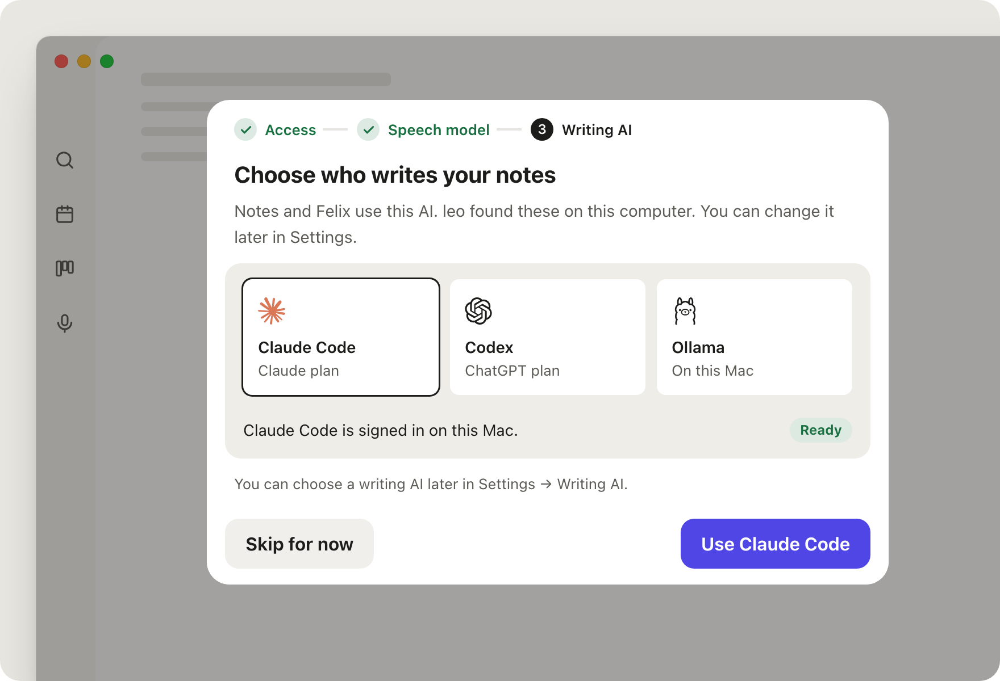
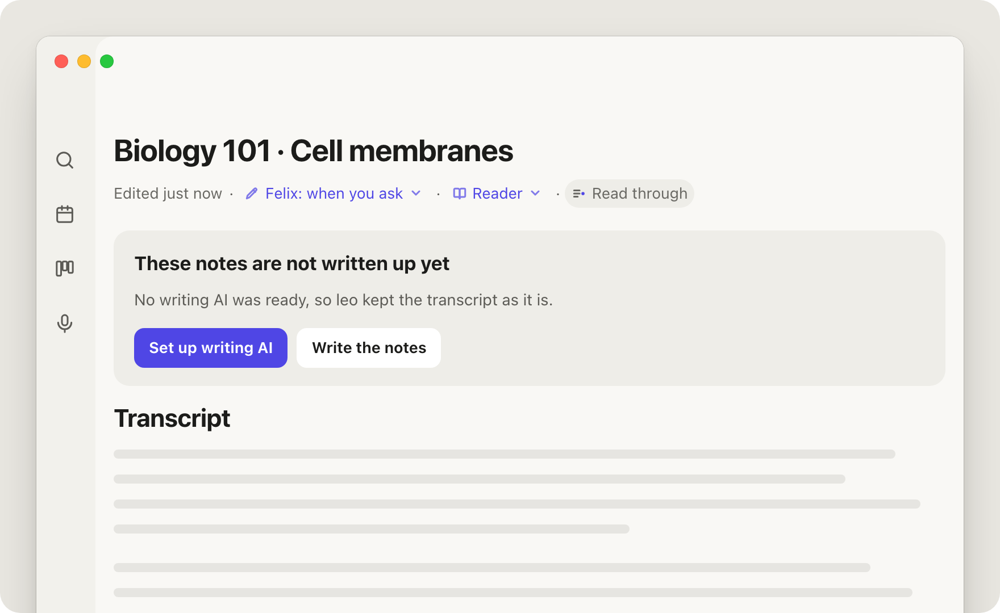
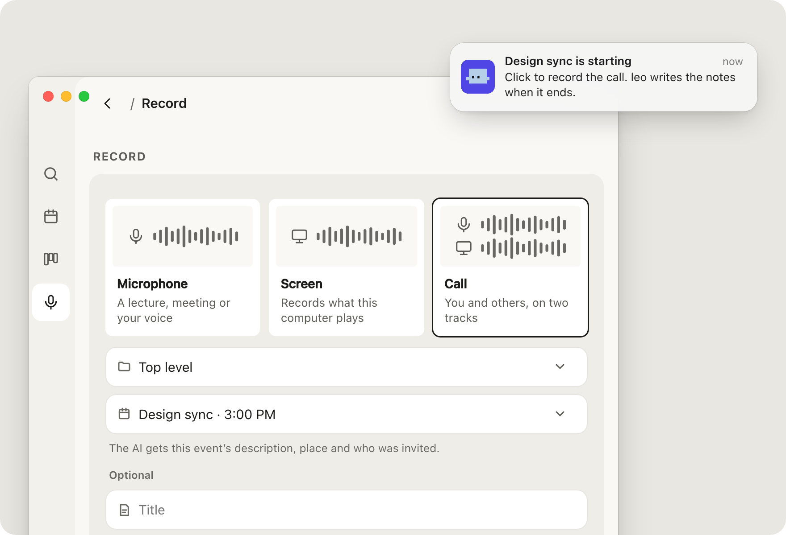

# Reducing friction in leo

Research date: 2026-11-09. Question: how can leo reduce user friction compared
with Wispr Flow, Granola, Riddled and a general chat app (Claude, ChatGPT)?
This folder holds the evidence and a ranked list of actionable items to go
through together.

| File | What it is |
|------|------------|
| [README.md](README.md) | This summary and the action list |
| [user-simulation-report.md](user-simulation-report.md) | Six simulated first-time users and where they got stuck |
| [codebase-analysis.md](codebase-analysis.md) | The code that shapes friction, and what blocks the fixes |
| [system-design.md](system-design.md) | Design for the two structural items: writing AI that works on first run, and calendar-triggered recording |
| [mockups/](mockups/) | Stills of three proposals, drawn in leo's own look |

## Summary

Leo's capture side is in good shape. Permissions, local speech, recording that
survives a closed window or a crash, and a live notepad all compare well with
the competitors. The friction is concentrated in one place: **the writing AI**.
It is required for leo's headline promise ("get the notes, then get quizzed"),
yet first-run setup never mentions it, the default (Ollama) is rarely installed,
every alternative needs a terminal, and when it is missing the app saves a raw
transcript and says "Your recording is now a note."

Five of six simulated users hit this. It is a blocker for anyone non-technical
and a silent failure for everyone else. Each competitor's equivalent step is
either built in (Granola, Wispr Flow, ChatGPT) or a sign-in in the app.

Three other themes follow:

1. **Errors don't lead to fixes.** About 14 versions of the "no writing AI"
   error exist; one links to Settings. Health tells Windows users to run `brew`
   and suggests cloud speech keys that no longer exist, which contradicts the
   privacy promise.
2. **Leo doesn't start things for you.** Granola prompts when a meeting starts;
   Wispr Flow teaches its key during setup; chat apps open on a text box. Leo
   opens on "Pick a note on the left".
3. **Output is hard to take elsewhere.** Share means print to PDF; Felix answers
   have no copy, retry or edit.

## How the others remove friction (baseline)

| | Wispr Flow | Granola | Riddled | Claude / ChatGPT | leo today |
|---|---|---|---|---|---|
| **AI to set up** | None: cloud AI built in | None: built in | None: built in | None: it is the AI | Pick Claude Code, Codex or Ollama, each needs a terminal; not in onboarding |
| **First-run teaching** | Mic test, hotkey, then a practice sandbox with mock Gmail and Notion | User type picks default templates | n/a | Text box on launch | Permissions and speech model; the shortcut is never shown |
| **Start trigger** | Hold fn | Calendar notification, one click to capture | Write; AI stays quiet, asks when needed | Type | Open Record, choose kind, press Start |
| **When AI fails** | n/a (cloud) | n/a | n/a | Retry button | Note becomes a raw transcript under a success toast |
| **Taking output elsewhere** | Pastes into any app | Share link without an account, recipes, chat across meetings with citations | n/a | Copy, share link | Export as PDF via print |
| **Privacy** | Cloud; context awareness reads near the cursor (on by default) | Device audio, no bot; audio deleted after transcription; notes in US cloud | Cloud | Cloud | Speech fully local; writing goes to the chosen CLI's provider or stays local with Ollama |

Leo's advantage is real: local speech, no account, plain Markdown files, Felix
as a tutor. Keep it. The goal is to remove the setup that a cloud product never
needs, without giving up local-first.

Sources: [Wispr Flow context awareness](https://docs.wisprflow.ai/articles/4678293671-feature-context-awareness),
[Wispr Flow UX reference](https://cdn.jsdelivr.net/npm/@agent-native/core@0.124.6/corpus/templates/clips/desktop/design-refs/wispr-ux.md) (third party, quotes the official setup guide),
[Granola teardown](https://aiuxplayground.com/teardowns/granola/meeting-notes),
[How Granola works](https://zackproser.com/blog/how-does-granola-ai-work),
[Granola recipes](https://docs.granola.ai/help-center/getting-more-from-your-notes/recipes),
[Granola chat](https://docs.granola.ai/help-center/getting-more-from-your-notes/chatting-with-your-meetings),
[Riddled](https://www.riddled.ai/) and [About](https://www.riddled.ai/about) (from search summaries; the pages refused a direct fetch),
[ChatGPT record mode](https://help.openai.com/en/articles/11487532-record-mode),
[Claude vs ChatGPT projects](https://unmarkdown.com/blog/claude-projects-vs-chatgpt-projects).
Most competitor claims come from their own docs or reviews; treat numbers
(limits, prices) as approximate.

## Action items

Each item has an ID to refer to when we go through them. **Evidence** names
the personas (W Wispr switcher, G Granola switcher, S student, C chat user,
R Riddled writer, E evaluator) and whether I verified it in code. Effort is
S (hours), M (a day or two), L (a week or more).

### Now: quick fixes, no design decisions needed

| ID | Fix | Evidence | Effort |
|----|-----|----------|--------|
| **Q1** | Rewrite Health's fix text. Drop `brew install ollama` on Windows, `leo update (downloads the speech model)` and "choose OpenAI, Gemini or xAI, add its key" (`crates/leo-services/src/health.rs:236-244`). Give every writing and speech check a button to its Settings section. | S, E; verified | S |
| **Q2** | Make a failed write-up visible. Today `accept()` jumps to the note and shows "Your recording is now a note." even when the notes were not written (`crates/leo-web/src/web/recording.js:205-208`); the warnings never reach the note. Say "Saved the transcript. The notes were not written." with Set up writing AI, and show a notice on the note itself (mockup 3). | G, S, E; verified | S–M |
| **Q3** | One "no writing AI" message everywhere, with a link to Settings → Writing AI. Replace raw text like "every chat provider failed. Last error: …" in Felix, margin notes, uploads and the tray. | S, C, R; audit finding 3 | M |
| **Q4** | "Ready" means ready. Ollama shows Ready and a green Health tile with no model pulled, and `writing_ready()` counts Ollama as available without checking it is running (`crates/leo-services/src/ai/mod.rs:261`, `ai/provider/openai.rs:528`). So the dictation warning "No writing AI is set up yet" never shows on a fresh install. Use the Health check in both. | E, W; verified | S |
| **Q5** | Teach the dictation shortcut. End onboarding with "Press ⌥Space anywhere to dictate", and put the same line in the empty home state. | W | S |
| **Q6** | Platform words. The Record tip says "Open leo from the menu bar" on Windows (`recording.js:370`). Say "system tray" there. | S; verified | S |
| **Q7** | Copy that fits meetings as well as lectures. "Connect a calendar to name recordings after your classes", the "exam" placeholder, and Microphone's "A lecture, meeting or your voice" beside Call. Use the meeting template whenever Call is chosen, not only with a calendar event. | G | S |
| **Q8** | A Share menu: Copy as Markdown, Save .md, Export as PDF. Add Copy to Felix answers. | G, C | S–M |
| **Q9** | A denied microphone says so. Today the live label reads "No sound for a while: is the right microphone chosen, and not muted?". Check the permission and offer Open System Settings. | E | S |
| **Q10** | Interrupted work announces itself. The quit confirmation mentions a note being written; on the next launch a toast points to "Not saved yet" on the Record page. | E | S |
| **Q11** | One click for the speech model: "Download and use" instead of Download, then "Use and finish". | W, S | S |
| **Q12** | Say what leaves the computer. One line on the Writing AI page per provider ("Notes and transcripts you send go to Anthropic", "Ollama stays on this computer"), and list transcripts, boards and margin notes in the export description. | E | S |
| **Q13** | Margin notes for writers. "Ask Felix" on a selection opens a question box first (Enter alone asks generally). Label the persona chip as a choice ("Felix as Reader ▾") and show what Critic does. | R | S |

### Next: needs a small design (see system-design.md)

| ID | Fix | Evidence | Effort |
|----|-----|----------|--------|
| **N1** | **A Writing AI step in onboarding** that shows what leo found on this computer and preselects the first one that is ready (mockup 1). Never changes a choice the user already made. Needs the onboarding preferences migration (audit finding 5). | W, G, S, C | M |
| **N2** | **One readiness answer** for writing, used by Settings, Health, dictation, the tray and Record (audit findings 1 and 6). Prerequisite for N1, N3, Q3 and Q4. | audit | S–M |
| **N3** | **Pre-flight on the Record page**: speech model, microphone permission, writing AI, and for Call a warning when the output device is a headset. Warn, never block: recording must still work without a writing AI. | G, S, E | S–M |
| **N4** | **Sign in and install from the app.** Run the provider's own sign-in (for example `codex login`, which opens the browser) from a Sign in button; open Ollama's download page; pull an Ollama model with progress through its local API, reusing the speech download UI. | W, G, S | M |
| **N5** | **A chat-first way in.** The empty home state gets the Quick Leo box inline ("Ask Felix, search, or jot something"). Dropping files on the home screen asks "Ask Felix about these" or "Make notes from them". | C | M |
| **N6** | **Felix message actions**: copy, retry, edit the last question. | C | M |
| **N7** | **Instructions for Felix per note** ("only ask questions here"), kept in leo.db next to the note's margin threads and shown under the title. | R | M |
| **N8** | **Better dictation without AI**: a few more fillers and spoken self-corrections ("no wait, Tuesday"), checked against recent dictations so nothing meaningful is dropped. | W | M |

### Later: bigger bets, worth a decision first

| ID | Bet | Why | Effort |
|----|-----|-----|--------|
| **L1** | **Calendar-triggered recording prompt** (mockup 2): a system notification when a connected calendar's event starts, one click to a Call recording named after the event. Never starts recording by itself. | Granola's core loop; G | M–L |
| **L2** | **Easier calendar connect.** Today it is a pasted iCal secret address. Guided steps per provider at minimum; Google or Microsoft sign-in would need an OAuth app and verification. | G | M–L |
| **L3** | **A built-in local writer**: a small model run like speech (supervised child, verified download) so notes get written with no other program. Quality on long transcripts is the open question, so test first (see Experiments). | the root cause behind N1 and N4 | L |
| **L4** | **App-aware dictation style**: the desktop knows the frontmost app; pass its name (only the name, never text from the screen) to the polish prompt. | W | M |
| **L5** | **Custom words that learn** from edits to recent dictations. | W | M |

### Suggested order

1. **N2, Q4, Q1, Q3**: one truthful readiness answer, then messages that link to the fix. Cheap, and everything else builds on them.
2. **Q2, N3**: no more silent raw-transcript notes.
3. **N1, then N4**: the first-run path actually ends with a working writing AI.
4. The rest of the quick fixes, in any order.
5. Decide on **L1, L3** after measuring (below).

## Mockups

Rendered with leo's own stylesheet and markup copied from the app's templates,
framed with the stageshow rules. They are proposals, not the app.

**Proposal N1: a Writing AI step at the end of first-run setup.**

**Proposal Q2: a failed write-up says so where the user lands.**

**Proposal L1: a calendar event starting offers to record the call.**

## How confident we are

- **Verified in code (high):** writing AI default and missing detection; Ollama
  marked ready without a model; the raw-transcript note under a success toast;
  stale Health fix text; "menu bar" on Windows.
- **Inferred from walkthroughs (medium):** how long each step takes, which
  words confuse people, whether a person would find Felix or the share icon.
  The simulated users read the page code; nobody ran the app. Real users are
  slower and more distracted, so detours probably cost more than reported.
- **From competitor docs and reviews (medium to low):** the baseline table.
  Riddled's pages could not be fetched directly.

## Experiments to confirm

1. **Time to first written note**, fresh install to a written-up note, with five
   real people (two non-technical). Today's expected result: most never get
   there without help. Target: under ten minutes including the model download.
2. **How many recordings end as raw transcripts.** Leo has no telemetry, so count
   locally (sessions whose write-up fell back) and show it in Health; ask
   testers to share the number.
3. **Local writer quality (before L3):** write up 10 real lecture and meeting
   transcripts with a 3–8B local model and with Claude Code; compare structure,
   factual errors and time. Decide L3 only if the small model is good enough
   on long input.
4. **Calendar prompt acceptance (after L1):** how often the prompt is taken versus
   dismissed; if it is mostly dismissed, keep it off by default.

## Open questions

- Should leo ship a writing AI of its own (L3), or is a smooth sign-in to the
  user's existing plan (N1 + N4) enough? The second is cheaper; the first is the
  only path to Granola-level "it just works" for someone with no AI plan.
- Is leo for students, for meetings, or both? The copy says students; the Record
  page and the calendar say both. Q7 assumes both.
- How far should leo follow Riddled's quiet, questioning style for Felix by default?
  Today Reader is the default persona and reads along.
