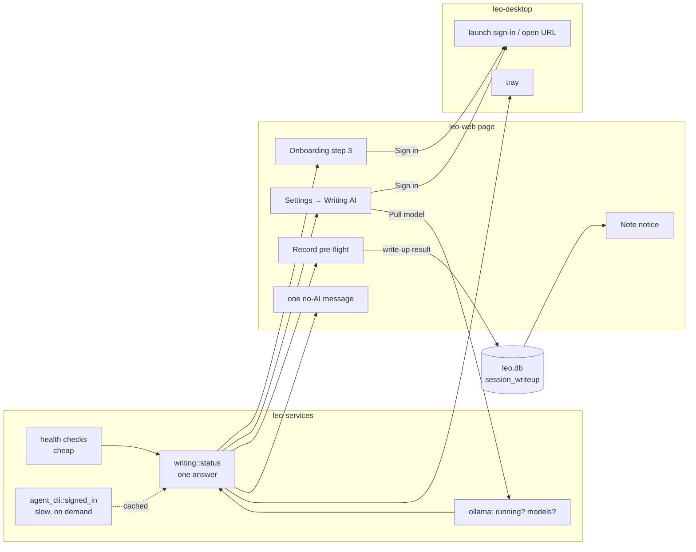

# Design: a writing AI that works on first run, and calendar-triggered recording

Covers the structural items in the action list: N1–N4 and Q2–Q4 (part A), and
L1 (part B). Everything else in the list is a local change.

## Summary

Leo's writing AI is an external program that the user installs and signs in
to. That can stay, since it is what keeps leo free and local-first. What
changes is who does the work. Leo **detects** what is already on the
computer, **asks once** during setup, **signs in or installs from the app**,
and **reports honestly** when writing fails. The decision everything else
depends on is a single `WritingStatus`, computed in one place in
leo-services, that every surface reads. The second decision is that a failed
write-up is recorded against the session in `leo.db`, never written into the
note file, so the note can show what happened and offer the fix.

Part B adds an engine-side "event starting" check on the existing calendar
refresh, plus a desktop notification. It never starts recording on its own.

---

## Part A: writing AI on first run

### Requirements

**Functional**
1. During first-run setup, show which writing AIs are on this computer and
   whether each is ready, and preselect the first ready one.
2. Let the user sign in (Claude Code, Codex) or install and pull a model
   (Ollama) without opening a terminal, as far as each program allows.
3. Every surface gives the same answer to "can leo write?": Settings, Health,
   dictation, the tray, the Record page, Felix and margin notes. Each "no"
   comes with the action that fixes it.
4. When a write-up fails, the note says so where the user lands, with "Set up
   writing AI" and "Write the notes".

**Non-functional** (from CLAUDE.md's capability-check rules)
- Startup checks stay cheap: a PATH scan, a key presence check (`has`, never a
  read), or a loopback connect with a 300 ms timeout. No DNS, no real AI request.
- **Sign-in probes run a child process** (`agent_cli::signed_in` runs the CLI's
  auth status), so they take hundreds of ms to seconds. Run them only on demand:
  the onboarding step, the Writing AI page, Health. Cache them for the session.
  Never run them on startup or per keystroke.
- Never change a writing choice the user already made.
- Recording must still work with no writing AI. Warn, never block.

Scale is one user on one machine: a handful of probes per session. There is
no throughput concern; the costs are latency and correctness.

### Boundaries

- **Inside**: detection, the readiness model, the onboarding step, sign-in and
  install launching, the Ollama model pull, failure reporting.
- **External**: the `claude` and `codex` programs and their sign-in flows, the
  Ollama server, the user's browser.
- **Assumptions to verify**:
  - `codex login` opens the browser and completes without a TTY. This is the
    documented flow; confirm it on macOS and Windows.
  - Claude Code's non-interactive sign-in. Leo's own copy says "run `claude`
    once and sign in", which is interactive. If no headless login exists, the
    fallback opens the system terminal with `claude` (macOS Terminal through
    `open`, Windows Terminal or `cmd`) and polls `signed_in` until it flips.
    This is the riskiest assumption in the design.
  - Ollama's `POST /api/pull` streams progress JSON on loopback.
- **Out of scope**: bundling a model (L3), OAuth for calendars (L2).

### Architecture



| Component | Where | Responsibility |
|---|---|---|
| `writing::status(cfg, store, probe)` | leo-services, beside `health.rs` | The only place that decides readiness. `probe: Probe::Cheap` or `Probe::SignIn` |
| `WritingStatus` JSON | `web_settings::describe` and a small `/api/writing` | What every page reads |
| Onboarding step 3 | `onboarding.js`, new `writing_done` preference | Shows candidates, preselects, saves the choice |
| Sign-in launcher | `AppApi` (desktop), `app-command` action | Runs `codex login`, or opens a terminal with `claude`; opens install URLs |
| Ollama pull | leo-host power over loopback `/api/pull` | Streams progress into the existing download UI |
| `session_writeup` table | `leo.db` | Session id, note id, outcome, reason; cleared by a successful "Write the notes" |
| One no-AI message | leo-services constant plus `why: "no-ai"` | Rendered by the page as text and a link |

### Data design

```rust
pub struct WritingStatus {
    pub provider: Option<String>,   // what the chat chain will use first
    pub state: WritingState,        // Ready | SignInNeeded | NotInstalled | NotRunning | NoModel | NotChosen
    pub fix: Option<Fix>,           // what to show next to it
    pub candidates: Vec<Candidate>, // only filled for Probe::SignIn: the onboarding step and the Writing AI page
}
pub enum Fix { OpenSettings, SignIn(Agent), Install { url: &'static str }, StartOllama, PullModel(&'static str) }
```

- **Rule for Ollama**: Ready only when the port answers *and* it has at least
  one model. `describe` already lists the models (`local.ollama`).
- **Preferences**: add `#[serde(default)] writing_done: bool` and stop growing
  `onboarding: [bool; 3]`. Relax `deny_unknown_fields` on `Preferences` so an
  older build still opens. **One-way door**: test the load in both directions.
- **`session_writeup`** in `leo.db` (local, not synced): `session_id TEXT
  PRIMARY KEY, note_id TEXT, outcome TEXT ('written' | 'transcript_only'),
  reason TEXT, at INTEGER`. Kept with the same lifetime as the session's
  recording sources. **Rejected alternative**: a front-matter flag in the note.
  It would put leo's operational state into the user's Markdown files, which
  Obsidian and git also read, and it would sync.

### API

- `GET /api/writing?probe=signin` returns `WritingStatus` (with `candidates`).
  Without `probe` it returns the cheap status.
- `POST /api/writing { action: "use", provider }` saves the chain the same way
  Settings does today.
- `POST /api/writing { action: "pull", model }` starts an Ollama pull. Progress
  appears in the GET, the same way speech downloads report it.
- Sign-in and install go through the existing `app-command` bridge
  (`AppApi`). Web stays dependent on core only.
- Errors: every route that needs writing returns `{ why: "no-ai", fix }`, not a
  string. The page renders one message with a link.

### Flows

**First run.** Access, then Speech model, then Writing AI. The step calls
`/api/writing?probe=signin` once; a spinner covers the 1–3 s of probes. The
first candidate that is Ready is preselected, in this order: Claude Code signed
in, Codex signed in, Ollama with a model. Use saves the chain and sets
`writing_done`. Skip sets `writing_done` and leaves the default. Either way
the step never comes back.

**Sign in.** The Sign in button calls the launcher, and the page polls
`?probe=signin` every 2 s for up to 2 minutes. When the state flips to
Ready, the row turns into "Signed in" and is selected.

**Write-up fails.** The listener already gets `problems` from `write_up`.
When the outcome is transcript-only, it writes `session_writeup` before the
note is announced. The page's `accept()` checks the outcome. If it is
transcript-only, the toast reads "Saved the transcript. The notes were not
written." with the action Set up writing AI. The note page reads the row and
shows the notice from mockup 3. "Write the notes" reuses the existing
regenerate path in sources.js. A success clears the row.

### Trade-offs

| Decision | Chosen | Rejected and why |
|---|---|---|
| Who provides the AI | Detect and sign in to the user's existing program | Bundled local writer (L3): biggest win for users with no AI plan, but a multi-GB download and unproven quality on long transcripts. Measure first |
| Where readiness lives | One function in leo-services | Page-side merging (today): drifts, and four surfaces already disagree |
| Sign-in probe timing | On demand, cached for the session | At startup: breaks the cheap-check rule and slows launch |
| Failure record | `leo.db` row per session | Front matter: pollutes the user's files and syncs |
| Default when nothing is ready | Leave `ollama` and say so everywhere | Silently switch to a found provider: surprising, and it can send note text to a cloud provider the user didn't choose |

### Failure modes

| What breaks | Detected by | Response |
|---|---|---|
| A CLI auth probe hangs | Timeout (existing probe bounds) | `SignInNeeded` with an "unknown" tag; the row still offers Sign in |
| Sign-in expires mid-session | The write-up fails | Transcript saved, `session_writeup` row, honest toast and notice |
| Ollama stops during a pull | Pull stream ends early | The row shows the error with Retry; partial blobs are Ollama's to clean up |
| `codex login` needs a TTY on some version | The poll never flips | After 2 min, fall back to opening a terminal with the command, and say so |
| Preferences from a newer build | Unknown field on load | Ignored (after relaxing `deny_unknown_fields`), never a reset |

### Observability

Leo has no telemetry. Add local counters in `leo.db`: write-ups by outcome,
first-run step reached, sign-in attempts and successes. Show them on
Settings → Health as one line ("3 of 12 recordings saved as transcripts"),
so a user or tester can report them. Nothing leaves the machine.

### Testing

- Unit tests for `writing::status` over a fake config and store: each state,
  and Ollama with no model.
- Preferences round-trip: old file to new build, new file to old build.
- A node test for the onboarding step drawing from a canned `WritingStatus`.
- One Playwright test: a failed write-up shows the toast and the note notice
  (fake powers already return writing errors).

### Scaling and evolution

Load is not a concern. The growth paths are:
- **L3**: a built-in local writer becomes another provider kind that
  `writing::status` knows. Nothing above it changes.
- **More providers**: add a variant to `Agent`. The status, the step and the
  launcher take it as data.

---

## Part B: calendar-triggered recording (L1)

### Requirements

- When an event from a connected calendar starts (or 2 minutes before), show
  a system notification: "<event> is starting · Click to record the call."
- A click opens leo on Record with Call selected and the event chosen, ready to
  press Start. **Never start recording automatically**: consent stays with
  the user, and Granola works the same way.
- At most one prompt per event. None while a recording is already running.
  A switch in Settings → Calendar, on by default once a calendar is connected.
- Cheap: no new network calls beyond the existing feed refresh.

### Design

- **Engine** (`crates/leo-web/src/calendar.rs`): after each scheduled refresh,
  and on a 60 s tick that reads only the cached events, find events with
  `start - 2 min <= now < start + 10 min`. Skip events already prompted
  (`calendar_prompted(event_uid, start)` in `leo.db`), skip all-day events,
  and skip while a recording is live. Emit `EventStarting { uid, title, start }`
  through a new optional `Powers` or `AppApi` callback, so web still depends
  only on core.
- **Desktop**: add `tauri-plugin-notification`. On `EventStarting`, post the
  notification. A click focuses the window and navigates to
  `#/record?event=<uid>&kind=call`. macOS needs the notification permission;
  ask for it the first time the switch is on, not during onboarding.
- **Page**: `recording.js` already matches "event now" (`eventNow`); make it
  accept the `event` and `kind` query.

### Trade-offs and failure modes

- **Polling cached events versus OS calendar APIs**: polling reuses what leo
  already has and works with any iCal feed. EventKit or Outlook integration
  would remove the iCal paste (L2) but is per platform. Defer.
- **Clock skew or a stale feed**: the window is ±minutes, so a late refresh
  only delays the prompt. The prompt is advisory, so a missed one costs little.
- **Notification denied**: fall back to the tray pill ("Design sync is starting
  · Record"), which needs no permission.
- **Spam risk**: back-to-back meetings could produce a prompt every 30 minutes.
  The dedupe table plus the off switch cover it, and experiment 4 measures it.

## Review notes

- **Bottleneck**: sign-in probes, which are seconds. Kept off startup and cached.
- **Single point of failure**: none new. The design removes one, the five
  readiness copies.
- **Over-engineering check**: no new service, no new crate. One function, one
  table, one plugin. `Candidate` lists are only computed on demand.
- **Riskiest assumption**: a headless Claude Code sign-in. The terminal
  fallback keeps N1 useful even if it doesn't exist.
